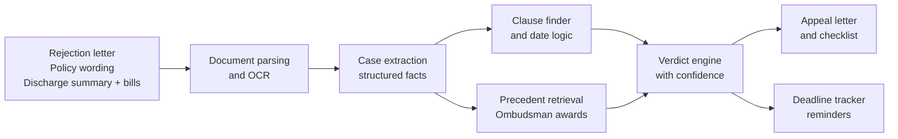

# ClaimBack

> **The $15-an-hour health-insurance claims expert.**
> Upload a rejection letter, the policy wording and the hospital bills. Get a clause-level verdict, supporting Ombudsman precedents and a ready-to-send appeal.

Built for **Homingo Hack Days 2026** · Track: **LLM apps** · Prompt: **C1 — "The $15-an-hour expert"**

**Status:** early. The award parser exists and is tested on synthetic data; the verdict pipeline is not built yet. See [`progress.md`](progress.md) for what is done and what is next.

---

## Table of contents

1. [The problem](#the-problem)
2. [What ClaimBack does](#what-claimback-does)
3. [Who it is for](#who-it-is-for)
4. [How it works](#how-it-works)
5. [How we measure it](#how-we-measure-it)
6. [Repository structure](#repository-structure)
7. [Getting started](#getting-started)
8. [Roadmap](#roadmap)
9. [Limitations and disclaimer](#limitations-and-disclaimer)
10. [Data sources](#data-sources)
11. [License](#license)

---

## The problem

Health-insurance claims in India are rejected or cut short at scale, and fighting a rejection takes expertise that most people do not have.

- Insurers processed **3.26 crore health claims in FY25; 87% were settled and 8% repudiated** ([IRDAI Annual Report 2024-25, via Insurance Business](https://www.insurancebusinessmag.com/asia/news/life-insurance/irdai-cannot-explain-why-health-insurance-claims-go-unpaid-583814.aspx)).
- Health insurance complaints **rose 41% to 1,37,361 in FY25**, driven mainly by claim disputes ([Angel One, citing IRDAI](https://www.angelone.in/news/personal-finance/irdai-data-reveals-41-spike-in-health-insurance-grievances-over-claim-settlements-in-fy25)).
- Insurers must state the specific reason for a rejection with reference to the policy terms ([Lok Sabha reply, 30 March 2026](https://taxguru.in/?p=1035064)). That makes the rejection letter a structured input an AI can reason over.
- The Insurance Ombudsman publishes its awards, which gives a public record of how disputes like these were actually decided ([CIO awards](https://www.cioins.co.in/AwardsMonthwise/Apr2021/Health_individual%20April%202021.pdf)).

Today, the person who can turn a rejection into a winning appeal is a claims specialist, an advocate or a very persistent relative. **A credential is the bottleneck.** ClaimBack aims to let an ordinary worker, such as a hospital insurance-desk executive, an agent or a patient's family member, do that work well.

## What ClaimBack does

Given a **rejection or partial-settlement letter**, the **policy wording** and the **discharge summary and bills**, ClaimBack will:

1. **Identify the stated ground**, for example waiting period, pre-existing disease, non-disclosure, room-rent proportionate deduction, "not medically necessary" or missing documents.
2. **Test whether the insurer applied it correctly.** It locates the actual policy clause and checks the facts and dates against it.
3. **Retrieve similar Ombudsman awards** and cite them.
4. **Give a verdict with a confidence level:** strong appeal, weak appeal, or the insurer appears to be right.
5. **Draft the appeal letter**, citing the clause and the precedents, with the correct escalation path and a list of missing documents.
6. **Track deadlines** and remind the user when to escalate.

Every claim in the output must point to a source (a policy clause or an award). If it cannot, it says so instead of guessing.

## Who it is for

| User | Why they care |
|---|---|
| Hospital insurance / billing desks | Denied cashless claims cost the hospital money |
| Insurance agents and corporate HR benefits desks | They field the complaint when a claim fails |
| Patients and families | They are paying the bill and do not know their rights |

## How it works



Design principles:

- **Grounded or silent.** No uncited legal claims. Citations are verified programmatically against the source documents.
- **Deterministic where possible.** Dates, waiting periods and amounts are computed by code, not by the model.
- **Calibrated.** The verdict reports confidence, and the system should say "weak case" when it is one.
- **Human in the loop.** The output is a draft for a person to review, not legal advice.

More detail in [`docs/architecture.md`](docs/architecture.md).

## How we measure it

The aim is evidence, not just a demo. The full protocol is in [`docs/evaluation.md`](docs/evaluation.md). In short:

| What | How |
|---|---|
| Outcome agreement | Strip the decision from held-out Ombudsman awards, predict it, compare with the real outcome |
| Clause match | Does the system identify the clause the Ombudsman relied on? |
| Citation hallucination rate | Every cited clause or award must exist in the source; target is 0% |
| Letter quality | Blind scoring of appeal letters by a domain expert |
| Baseline | A plain single-prompt LLM on the same cases, to show what the system adds |
| Real-user pilots | Real rejection letters, run with real users |

Known limitation: cases that reach the Ombudsman are not a random sample of all rejections, so accuracy on this set will not transfer one-to-one to all claims. We report this alongside the results.

Results will be added here once they exist. **None are claimed yet.**

## Repository structure

```
ClaimBack/
├── README.md            # this file
├── progress.md          # running log: done, in progress, next, decisions, risks
├── docs/
│   ├── architecture.md  # pipeline, data schemas, design decisions
│   └── evaluation.md    # benchmark and study protocol
├── data/
│   ├── README.md        # what to download and how (no raw data is committed)
│   ├── raw/             # downloaded PDFs (git-ignored)
│   └── processed/       # parsed awards and policy text (git-ignored)
├── src/claimback/       # application code
│   └── awards/          # award PDF text -> structured cases
├── prompts/             # versioned prompts
├── eval/                # benchmark and evaluation scripts
└── tests/               # unit tests
```

## Getting started

The full product is not runnable yet. What exists today is the award ingestion step:

```bash
pip install -e ".[dev]"
pytest                                   # parser tests (synthetic fixtures)
python -m claimback.awards.build --raw data/raw/awards --out data/processed/awards.jsonl
```

The build step needs Ombudsman award PDFs in `data/raw/awards/`; see [`data/README.md`](data/README.md). Track the build in [`progress.md`](progress.md).

## Roadmap

**Hackathon scope (Homingo Hack Days 2026)**

- [ ] Ombudsman award corpus and benchmark harness
- [ ] Policy parser, clause finder and date logic
- [ ] Verdict engine and appeal-letter generator
- [ ] Evaluation results against a plain-LLM baseline
- [ ] Real-user pilots
- [ ] Live demo and deck

**After the hackathon (ideas, not commitments)**

- Voice intake in regional languages
- Hospital billing-desk workflow and per-case pricing
- Coverage of more claim types

## Limitations and disclaimer

ClaimBack is an **information and drafting tool**. It does not give legal advice, does not guarantee any outcome, and its drafts should be reviewed by the user (and by a professional for high-value claims) before sending. Policy terms and IRDAI rules change; verify against current documents.

## Data sources

- Insurance Ombudsman awards: [cioins.co.in](https://www.cioins.co.in)
- IRDAI circulars and annual reports
- Insurer policy wordings, published on insurer websites

Check each source's terms of use before redistributing anything. Raw data is not committed to this repository.

## License

MIT. See [`LICENSE`](LICENSE).
